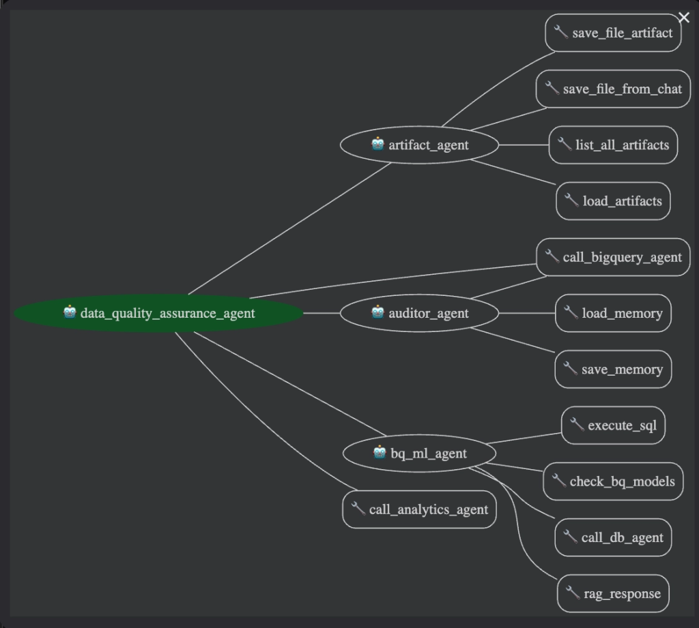

# Data Quality Assurance Agent

[](LICENSE)
[](https://www.python.org/downloads/)
[](https://google.github.io/adk-docs/)

An intelligent multi-agent system built on [Google's Agent Development Kit (ADK)](https://google.github.io/adk-docs/) that performs automated data quality assurance on BigQuery tables — identifying structural errors, logical business-rule violations, and statistical anomalies. Through persistent memory, it refines its analysis across sessions and delivers increasingly targeted insights.

**Inspired by:** [How to build a Data Science agent with ADK](https://www.youtube.com/watch?v=efcUXoMX818) (Google ADK sample)

## Architecture



## Key Features

*   **Multi-Agent Architecture** — Top-level agent orchestrates specialized sub-agents for SQL generation, analytics, ML, auditing, and reporting.
*   **Natural Language to SQL (NL2SQL)** — Query BigQuery using natural language, with support for [CHASE-SQL](https://arxiv.org/abs/2410.01943) or baseline Gemini generation.
*   **Data Science Analysis (NL2Py)** — Generate Python visualizations and analysis from natural language instructions.
*   **Machine Learning (BQML)** — Train and evaluate ML models using BigQuery ML.
*   **Artifact & Report Generation** — Save plots, PDFs, and reports to GCS with persistent artifact storage.
*   **Persistent Memory** — Saves user preferences and domain context across sessions via Vertex AI Memory Bank.
*   **Flexible Connectivity** — BigQuery, AlloyDB, and MCP Toolkit for databases via the [ADK Built-in BigQuery Tool][adk-builtin-tool-bq].
*   **Agent-to-Agent (A2A)** — Exposes an A2A API for inter-agent communication.

## Quickstart

### Prerequisites

*   Google Cloud account with BigQuery enabled
*   Python 3.12+
*   [uv](https://docs.astral.sh/uv/getting-started/installation/)

### Setup

```bash
git clone <repo-url> && cd data_science_agent_adk
make setup        # installs deps, pre-commit hooks, creates .env
```

Edit `.env` with your GCP project details (see `.env.example` for all options).

### Authenticate

```bash
gcloud auth login
gcloud auth application-default login
gcloud config set project "<YOUR_PROJECT_ID>"

gcloud services enable sqladmin.googleapis.com \
   compute.googleapis.com \
   cloudresourcemanager.googleapis.com \
   servicenetworking.googleapis.com \
   aiplatform.googleapis.com
```

*NOTE: Ensure the identity you use has at minimum `Vertex AI User`, `BigQuery Data Editor`, and `BigQuery Job User` roles.*

### Run

```bash
make run          # CLI mode
make web          # ADK Web UI
make docker-run   # Docker
```

<a id="bigquery-setup"></a>
## Database Setup

Set `BQ_DATA_PROJECT_ID` and `BQ_COMPUTE_PROJECT_ID` in `.env` (can be the same project). Set `BQ_DATASET_ID` to your target dataset.

For sample datasets and loading instructions, see [docs/datasets.md](docs/datasets.md).

## Optional Setup

### BQML RAG Corpus

The BQML Agent can use Vertex AI RAG Engine to query the BigQuery ML Reference Guide. To enable:

```bash
python3 data_science/utils/reference_guide_RAG.py
```

### Code Interpreter

Provide a pre-existing extension resource name in `CODE_INTERPRETER_EXTENSION_NAME`, or leave empty to auto-create one on first run.

### NL2SQL Method

Set `NL2SQL_METHOD` to `BASELINE` (Gemini) or `CHASE` (CHASE-SQL) in `.env`.

## Example Interaction

> **User:** What data do you have access to?

> **Agent:** I have access to two tables: `train` and `test`. Both contain sticker sales data with columns: `id`, `date`, `country`, `store`, `product`, and `num_sold`.

> **User:** Please generate a plot with total sales per country.

> **Agent:** A bar plot has been generated showing total sales per country. The database agent retrieved the data, then the data science agent generated the visualization.

## Testing

```bash
make test         # unit tests
make eval         # agent evaluations
make check        # lint + tests (CI equivalent)
```

## Development

All common commands are available via `make`:

| Command | Description |
| --- | --- |
| `make setup` | Full setup: install deps, pre-commit hooks, create `.env` |
| `make install` | Install project dependencies |
| `make lint` | Run linting with ruff |
| `make format` | Auto-format code with ruff |
| `make test` | Run unit tests |
| `make eval` | Run agent evaluations |
| `make run` | Run the agent in CLI mode |
| `make web` | Run the agent with ADK web UI |
| `make check` | Run lint + tests (CI equivalent) |
| `make docker-build` | Build Docker image |
| `make docker-run` | Run the agent in Docker |
| `make clean` | Remove build artifacts and caches |

Run `make help` to see all available targets.

## Documentation

| Topic | Link |
| --- | --- |
| Sample Datasets & Loading | [docs/datasets.md](docs/datasets.md) |
| Artifact Management & Reports | [docs/artifacts-and-reports.md](docs/artifacts-and-reports.md) |
| Deployment on Cloud Run | [docs/deployment.md](docs/deployment.md) |
| Agent-to-Agent (A2A) API | [docs/a2a.md](docs/a2a.md) |
| Troubleshooting | [docs/troubleshooting.md](docs/troubleshooting.md) |

## Extending the Agent

*   Add your own sub-agents or tools in `data_science/sub_agents/` and register them in `data_science/agent.py`.
*   Import individual sub-agents (e.g., just the BigQuery agent) as an `AgentTool` in your own root agent.
*   Customize model selection per agent via environment variables (see `.env.example`).

## Contributing

See [CONTRIBUTING.md](CONTRIBUTING.md) for guidelines.

## License

[Apache License 2.0](LICENSE)

## Disclaimer

This agent sample is provided for illustrative purposes only and is not intended
for production use. It serves as a foundational starting point for developing
your own agents. Users are responsible for any further development, testing,
security hardening, and deployment.


[adk-builtin-tool-bq]: https://google.github.io/adk-docs/tools/built-in-tools/#bigquery
