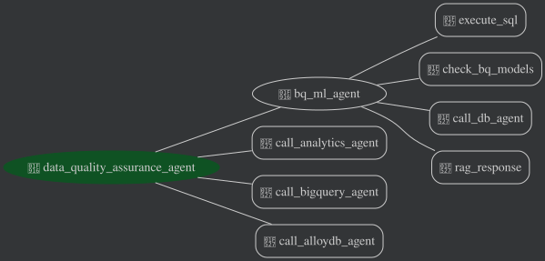

# Data Quality Assurance Agent

> **Note:** This repository has been migrated to WPPOpen to be open sourced. All future fixes and improvements will be done on the [WPPOpen repository](https://github.com/WPPOpen/x-wppopen-researchlab_wpp_data_quality_assurance_agent).

## Table of Contents

- [Executive Summary](#executive-summary)
- [Overview](#overview)
- [Agent Details](#agent-details)
  - [Architecture](#architecture)
  - [Key Features](#key-features)
- [Agent Setup and Installation](#agent-setup-and-installation)
  - [Prerequisites](#prerequisites)
  - [ADK Project Setup with uv](#adk-project-setup-with-uv)
- [Database Setup](#database-setup)
  - [BigQuery Setup](#bigquery-setup)
- [Sample Datasets](#sample-datasets)
  - [Dataset Configuration](#dataset-configuration)
  - [Forecasting Sticker Sales Dataset](#forecasting-sticker-sales-dataset)
  - [Cymbal Airlines Flights Dataset](#cymbal-airlines-flights-dataset)
- [Artifact Management](#artifact-management)
- [Report Generation](#report-generation)
  - [JSON Statistical Analysis](#json-statistical-analysis)
- [Running the Agent](#running-the-agent)
  - [Example Agent Interaction](#example-agent-interaction)
- [Testing and Evaluation](#testing-and-evaluation)
  - [Running Evaluations](#running-evaluations)
  - [Running Tests](#running-tests)
- [Development Tools](#development-tools)
  - [Pre-commit Hooks](#pre-commit-hooks)
- [Optimizing and Adjustment Tips](#optimizing-and-adjustment-tips)
- [Troubleshooting](#troubleshooting)
- [Deployment on Google Cloud Run](#deployment-on-google-cloud-run)

- [Agent-to-Agent (A2A) API Interface](#agent-to-agent-a2a-api-interface)
- [Disclaimer](#disclaimer)

## Executive Summary

The Data Quality Assurance Agent is an intelligent multi-agent system built on Google's Agent Development Kit (ADK). It performs automated quality assurance on marketing tables in BigQuery — identifying structural errors, logical business-rule violations, and statistical anomalies. Through persistent memory, it saves and recalls user preferences and domain-specific context, enabling it to refine its analysis across sessions and deliver increasingly targeted insights.


## Overview

This project implements a multi-agent system designed for automated data quality assurance. It integrates several specialized agents to handle different aspects of the data quality pipeline, from data retrieval and auditing to advanced analytics and machine learning. The system is built to interact with BigQuery, perform complex data manipulations, generate data visualizations, and execute machine learning tasks using BigQuery ML (BQML). The agent can generate text responses as well as visuals, including plots and graphs for data analysis and exploration.

▶️ **Watch the Video Walkthrough:** [How to build a Data Science agent with
ADK](https://www.youtube.com/watch?v=efcUXoMX818)

## Agent Details
The key features of the Data Quality Assurance Agent include:

| Feature | Description |
| --- | --- |
| **Interaction Type:** | Conversational |
| **Complexity:**  | Advanced |
| **Agent Type:**  | Multi Agent |
| **Components:**  | Tools, AgentTools, Session Memory, RAG, MCP Toolkit for Databases, ADK Builtin BigQuery Tools |
| **Vertical:**  | All (Applicable across industries needing advanced data analysis) |


### Architecture


### Key Features

*   **Multi-Agent Architecture:** Utilizes a top-level agent that orchestrates
    sub-agents, each specialized in a specific task.
*   **Flexible Data Sources:** Support for BigQuery, allowing you to work with data where it lives.
*   **Robust Connectivity:** Uses the [ADK Built-in BigQuery Tool][adk-builtin-tool-bq] for reliable database interactions.
*   **Advanced Data Configuration:** New configuration format supports runtime data source selection and logical cross-dataset joins.
*   **Database Interaction (NL2SQL):** Employs a Database Agent to interact with
    BigQuery using natural language queries, translating them into SQL.
*   **Data Science Analysis (NL2Py):** Includes a Data Science Agent that
    performs data analysis and visualization using Python, based on natural
    language instructions.
*   **Machine Learning (BQML):** Features a BQML Agent that leverages BigQuery
    ML for training and evaluating machine learning models.
*   **Code Interpreter Integration:** Supports the use of a Code Interpreter
    extension in Vertex AI for executing Python code, enabling complex data
    analysis and manipulation.
*   **Rich Sample Data:** Includes a new sample dataset (simulating a fictional airline) to demonstrate cross-dataset capabilities.
*   **ADK Web GUI:** Offers a user-friendly GUI interface for interacting with
    the agents.
*   **Testability:** Includes a comprehensive test suite for ensuring the
    reliability of the agents.


## Agent Setup and Installation

### Prerequisites

*   **Google Cloud Account:** You need a Google Cloud account with BigQuery
    enabled.
*   **Python 3.12+:** Ensure you have Python 3.12 or a later version installed.
*   **uv:** Install uv by following the instructions on the official uv website:
    [https://docs.astral.sh/uv/getting-started/installation/](https://docs.astral.sh/uv/getting-started/installation/)
*   **Git:** Ensure you have git installed. If not, you can download it from
    [https://git-scm.com/](https://git-scm.com/) and follow the [installation
    guide](https://git-scm.com/book/en/v2/Getting-Started-Installing-Git).


### ADK Project Setup with uv

First, you need to install and configure the core ADK agent. After this you'll
set up the data sources to be used with the agent.

1.  **Clone the Repository:**

1.  **Install Dependencies with uv (Python 3.13 recommended):**

    ```bash
    uv sync --python 3.13
    ```

    This command reads the `pyproject.toml` file and installs all the necessary
    dependencies into a virtual environment managed by uv. On the first run,
    this command will also create a new virtual environment.

    By default, the virtual environment will be created in a `.venv` directory
    inside `adk-samples/python/agents/data-science`. If you already have a virtual
    environment created, or you want to use a different location, you can use
    the `--active` flag for `uv` commands, and/or change the
    `UV_PROJECT_ENVIRONMENT` environment variable. See
    [How to customize uv's virtual environment location](https://pydevtools.com/handbook/how-to/how-to-customize-uvs-virtual-environment-location/)
    for more details.

1.  **Activate the uv Shell:**

    If you are using the `uv` default virtual environment, you now need
    to activate the environment.

    ```bash
    source .venv/bin/activate
    ```

1.  **Set up Environment Variables:**

    Rename the file ".env.example" to ".env"
    Fill the below values:

    ```bash
    # Choose Model Backend: 0 -> ML Dev, 1 -> Vertex
    GOOGLE_GENAI_USE_VERTEXAI=1

    # Vertex backend config
    GOOGLE_CLOUD_PROJECT='YOUR_VALUE_HERE'
    GOOGLE_CLOUD_LOCATION='YOUR_VALUE_HERE'

    BQML_RAG_CORPUS_NAME=''

    CODE_INTERPRETER_EXTENSION_NAME=''

    BQ_DATASET_ID=''
    BQ_DATA_PROJECT_ID=''
    BQ_COMPUTE_PROJECT_ID=''

    DATASET_CONFIG_FILE=''

    BQML_AGENT_MODEL=''
    ROOT_AGENT_MODEL=''
    BIGQUERY_AGENT_MODEL=''
    ANALYTICS_AGENT_MODEL=''
    BASELINE_NL2SQL_MODEL=''
    ARTIFACT_AGENT_MODEL=''

    # Optional: Vertex AI Agent Engine Memory Bank configuration
    MEMORY_SERVICE_URI=''

    # Optional: GCS bucket for persistent artifact storage (images, PDFs, reports)
    ARTIFACT_BUCKET_NAME=''
    ```

    *NOTE: Ensure that the identity you are using to run the agent has the appropriate Google Cloud IAM permissions granted on your project. At a minimum, you will need roles such as `Vertex AI User`, `BigQuery Data Editor`, and `BigQuery Job User` for the core features to work.*

<a id="authenticate-the-google-cloud-cli"></a>
1.  **Authenticate the Google Cloud CLI:**
    - A Google Cloud project with billing enabled.
    - gcloud CLI ([Installation instructions](https://cloud.google.com/sdk/docs/install))
    - Authenticate the Google Cloud CLI, and enable Google Cloud APIs.

    ```bash
    gcloud auth login
    gcloud auth application-default login

    export PROJECT_ID="<YOUR_PROJECT_ID>"
    gcloud config set project "<YOUR_PROJECT_ID>"

    gcloud services enable sqladmin.googleapis.com \
       compute.googleapis.com \
       cloudresourcemanager.googleapis.com \
       servicenetworking.googleapis.com \
       aiplatform.googleapis.com
    ```

1.  **BQML Setup (Optional):**

    The BQML Agent can use the Vertex AI RAG Engine to query the full BigQuery ML Reference Guide for syntax help. **This step is entirely optional.** If you skip it, the agent will rely on its pre-trained knowledge to write SQL queries.

    If you choose to enable this feature, ensure your project ID is added in the `.env` file under `"GOOGLE_CLOUD_PROJECT"`. Leave the corpus name empty: `BQML_RAG_CORPUS_NAME = ''`. The corpus name will be added automatically once created.

    To set up the RAG Corpus for your project, run the following command from the working directory:

    ```bash
    python3 data_science/utils/reference_guide_RAG.py
    ```

    *NOTE: The default documents that the RAG engine ingests are located [here](https://console.cloud.google.com/storage/browser/cloud-samples-data/adk-samples/data-science/bqml?authuser=1&pageState=(%22StorageObjectListTable%22:(%22f%22:%22%255B%255D%22))).*


1.  **Code Interpreter Setup:**

    The Data Science Agent also relies on a Vertex AI Code Interpreter extension.

    If an extension has already been created, provide the full resource name of
    the pre-existing Code Interpreter extension
    (e.g., `projects/<YOUR_PROJECT_ID>/locations/<YOUR_LOCATION>/extensions/<YOUR_EXTENSION_ID>`).
    in the `CODE_INTERPRETER_EXTENSION_NAME` variable in the .env file.

    If an extension name is not provided, a new extension will be created.
    Check the logs for the Vertex Extension ID and provide the value in your
    environment variables for future runs to avoid creating multiple extensions.


1. **NL2SQL Configuration:**

    For BigQuery NL2SQL generation, the gent can use one of two methods: either
    querying Gemini directly, or [CHASE-SQL](https://arxiv.org/abs/2410.01943).
    Set the variable `NL2SQL_METHOD` to either `BASELINE` (to use Gemini) or
    `CHASE` to use CHASE-SQL.

1.  **Run the agent:**

    Run agent with ADK Web UI:
    ```bash
    uv run adk web
    ```

    For more information on running the agent, such as via the CLI, please see the [Running the Agent](#running-the-agent) section below.

## Database Setup

This sample has two alternate data sets that can be used. The
`ticket_sales_history` dataset uses BigQuery.

The `cymbal_flights` dataset also uses BigQuery.

<a id="bigquery-setup"></a>
### BigQuery Setup

Set the BigQuery project IDs in the `.env` file. This can be the same GCP
Project you use for `GOOGLE_CLOUD_PROJECT`, but you can use other BigQuery
projects as well, as long as you have access permissions to that project.

In some cases you may want to separate the BigQuery compute consumption from
BigQuery data storage. You can set `BQ_DATA_PROJECT_ID` to the project you
use for data storage, and `BQ_COMPUTE_PROJECT_ID` to the project you want to
use for compute. Otherwise, you can set both `BQ_DATA_PROJECT_ID` and
`BQ_COMPUTE_PROJECT_ID` to the same project id.

If you have an existing BigQuery table you wish to connect, specify the
`BQ_DATASET_ID` in the `.env` file as well. Otherwise set this value
according to the choice of sample dataset (see above).

We recommend not adding any production critical datasets to this sample agent.


## Sample Datasets

The Data Science agent includes two different sample datasets that showcase
different aspects of its capabilities.

### Dataset Configuration
To configure the Data Science Agent to use the correct dataset, you
will need to give it the name of a dataset configuration file in
the environment variable `DATASET_CONFIG_FILE`. Two sample configuration
files are provided: `dataset_configs/forecasting_sticker_sales_dataset_config.json`
and `dataset_configs/flights_dataset_config.json`, corresponding to the two datasets
described below. In your `.env. file, set the environment variable
as either
```bash
DATASET_CONFIG_FILE='./dataset_configs/forecasting_sticker_sales_dataset_config.json'
```
or
```bash
DATASET_CONFIG_FILE='./dataset_configs/flights_dataset_config.json'
```
#### Dataset Configuration File Format
The two provided configuration files give examples of how to specify
a dataset configuration. The file is a standard JSON format, with
two main sections: `datasets` and `cross_dataset_relations`.

Each entry in `datasets` must contain the following fields: `type`,
`name`, and `description`. The description field is passed to the
root data science agent to help it decide how to use that dataset,
so ensure the description is written to be useful to the agent.

The `cross_dataset_relations` element contains an array,
`foreign_keys`, with entries for each foreign key relation between the
datasets the agent has access to. A `foreign_key` entry has two
fields, `child` and `parent`, each with the same fields:
* `type`: The type of the dataset (must match the type in the
    datasets field)
* `dataset`: The name of the dataset (must be one of the datasets
    configured in the datasets field)
* `table`: The table in the dataset where the key field is found
* `column`: The column in the dataset containing the key entries.

### Forecasting Sticker Sales Dataset ###

***NOTE:** This dataset uses BigQuery only. Make sure to follow the steps in the
[BigQuery Setup](#bigquery-setup) section to setup and configure the
agent to access BigQuery.*

The dataset contains two tables, `train` and `test`, to enable forecasting
and BQML analytics queries.

You first need to download the dataset from [GitHub](https://github.com/google/adk-samples/tree/main/python/agents/data-science/data_science/utils/data/). To load this dataset into BigQuery, make sure you are still in the working directory
(`agents/data-science`). Then run the following commands:
```bash
python3 data_science/utils/create_bq_table.py
```

Set the following environment variable in your `.env` file to use this dataset:
```
BQ_DATASET_ID='forecasting_sticker_sales'`
```
Dataset source: _Walter Reade and Elizabeth Park. Forecasting Sticker Sales.
https://kaggle.com/competitions/playground-series-s5e1, 2025. Kaggle._

### Cymbal Airlines Flights Dataset ###

***NOTE:** This dataset uses BigQuery. Follow the steps in the [BigQuery Setup](#bigquery-setup)
section to setup the database and configure the agent for database access.*

You can find the flights dataset [here on GitHub](https://github.com/google/adk-samples/tree/main/python/agents/data-science/flights_dataset).

1. Configure the environment variables as directed in the BigQuery Setup section below.
Also export the BigQuery dataset id for this sample dataset:

    ```bash
    export BQ_DATASET_ID=flights_dataset
    ```

1. Run this command to create a new BigQuery dataset:
    ```bash
    bq mk --location $GOOGLE_CLOUD_LOCATION --dataset $BQ_DATA_PROJECT_ID:$BQ_DATASET_ID
    ```
1. Run these commands from the `data-science/flights_dataset` directory to load the
data into BigQuery:

    ```bash
    bq --project_id=$BQ_DATA_PROJECT_ID --location=$GOOGLE_CLOUD_LOCATION \
        load --source_format=CSV --autodetect --skip_leading_rows=1 --replace \
        $BQ_DATASET_ID.flight_history flight_history_table.csv
    bq --project_id=$BQ_DATA_PROJECT_ID --location=$GOOGLE_CLOUD_LOCATION \
        load --source_format=CSV --autodetect --skip_leading_rows=1 \
        --allow_quoted_newlines --replace \
        $BQ_DATASET_ID.cymbalair_policies cymbalair_policies_table.csv
    bq --project_id=$BQ_DATA_PROJECT_ID --location=$GOOGLE_CLOUD_LOCATION \
        load --source_format=CSV --autodetect --skip_leading_rows=1 --replace \
        $BQ_DATASET_ID.ticket_sales_history ticket_sales_history_table.csv
    ```

## Artifact Management

The agent includes an **Artifact Agent** — a dedicated sub-agent for managing
files and data within a session. It acts as the central file system for the
multi-agent workflow, enabling agents and users to persist and retrieve work
products across conversation turns.

**What the Artifact Agent can do:**

*   **Save files uploaded in chat** — When a user drags and drops an image, PDF,
    or other file into the chat, the agent can persist it as a session artifact
    without converting it to base64, avoiding token overhead.
*   **Persist generated content** — Text, CSVs, and JSON data generated during analysis
    can be saved using `save_file_artifact`.
*   **List available artifacts** — Show all files saved in the current session.
*   **Embed artifacts in reports** — Use saved artifacts (e.g., plots, images) in
    markdown, HTML, or PDF reports generated by the Report Agent.
*   **GCS-backed persistent storage** — When configured with a GCS bucket,
    artifacts are stored in Google Cloud Storage for durability beyond a single
    server session.

**Key tools:**

| Tool | Use Case |
| --- | --- |
| `save_file_from_chat` | Save a file uploaded by the user in the chat (images, PDFs). Extracts bytes directly from the conversation — **no base64 token overhead**. |
| `save_file_artifact` | Save content provided as a string (text files) or base64 (binary). Use as a last resort. |
| `list_all_artifacts` | List all artifacts in the current session. |

## Report Generation

The **Report Agent** is specialized in creating comprehensive reports summarizing data analysis, visualizations, and insights. It supports generating reports in multiple formats.

**Key tools:**

| Tool | Use Case |
| --- | --- |
| `save_report_markdown` | Save the report as a Markdown file. |
| `save_report_html` | Convert the report to HTML and save it. |
| `save_report_pdf` | Generate a PDF report, including embedded images and charts. |
| `json_statistical_analysis` | Generate a comprehensive JSON profile of a BigQuery table (schema, numerical stats, categorical distributions). |
| `save_json_statistical_report` | Save the JSON analysis result as an artifact **and** upload it directly to GCS. |

**Embed Artifacts in Reports:**
You can embed saved artifacts (plots, images) directly into your reports using the syntax: ``. The Report Agent will automatically resolve these references and embed the actual image data in the final PDF or HTML output.

### JSON Statistical Analysis

The `json_statistical_analysis` tool generates a structured JSON profile for any BigQuery table accessible by the agent. The output includes:

*   **Metadata** — table name, generation timestamp, high-cardinality column flags.
*   **Schema summary** — total rows, column count, column names.
*   **Numerical statistics** — mean, std, min, max, and null count for every numeric column.
*   **Categorical distributions** — top-5 class distribution (with percentages) for every categorical column; high-cardinality columns (>50 distinct values) are flagged and their full distribution is omitted for brevity.

The resulting JSON is automatically saved as a session artifact (named after the table, e.g. `my_dataset_my_table.json`). When `ARTIFACT_BUCKET_NAME` is configured, the file is **also uploaded directly** to GCS under the path `gs://<bucket>/json_reports/<filename>`, ensuring the analysis is persisted in the bucket regardless of session lifecycle.

**GCS Storage Setup:**

1.  Create a GCS bucket:
    ```bash
    gcloud storage buckets create gs://YOUR_BUCKET_NAME \
        --location=us-central1 \
        --project=YOUR_PROJECT_ID \
        --uniform-bucket-level-access
    ```

2.  Set `ARTIFACT_BUCKET_NAME` in your `.env` file:
    ```bash
    ARTIFACT_BUCKET_NAME='YOUR_BUCKET_NAME'
    ```

3.  When running locally with `adk web`, pass the flag (or use `./run_web.sh`):
    ```bash
    uv run adk web --artifact_service_uri gs://YOUR_BUCKET_NAME .
    ```

    When deployed via `main.py` or Cloud Run, the `ARTIFACT_BUCKET_NAME`
    env variable is read automatically.

## Running the Agent

You can run the agent using the ADK command in your terminal.
from the working directory:

1.  Run agent in CLI:

    ```bash
    uv run adk run data_science
    ```

1.  Run agent with ADK Web UI:
    ```bash
    uv run adk web
    ```
    Select the data_science from the dropdown

1.  Run agent with ADK Web UI and **GCS artifact storage**:
    ```bash
    uv run adk web --artifact_service_uri gs://YOUR_BUCKET_NAME .
    ```
    This enables persistent file storage — uploaded files, plots, and reports
    are saved directly to GCS instead of being lost on server restart.

1.  **Quick start with `run_web.sh`** (recommended for local development):
    ```bash
    ./run_web.sh
    ```

    This convenience script reads the `ARTIFACT_BUCKET_NAME` variable from your
    `.env` file and automatically passes it as `--artifact_service_uri` to
    `adk web`, so you don't have to type the full flag each time. If no bucket
    is configured in `.env`, it falls back to in-memory artifact storage.

     [!NOTE]
     If you encounter a "Permission denied" error when running a bash script for the first time, you may need to grant execution permissions by running `chmod +x <script_name>.sh` (e.g., `chmod +x run_web.sh`).

### Example Agent Interaction

Here's a quick example of how a user might interact with the Data Science
Multi-Agent System using the _Forecasting Sticker Sales_ dataset.

> ´**User:** Hi, What data do you have access to?

> **Agent:**  I have access to two tables: `train` and `test`. Both tables
contain sticker sales data with the following columns: `id`, `date`, `country`,
`store`, `product`, and `num_sold`.

> **User:** I need more details on the train table. What countries exist? How
many stores are there?

> **Agent:** Result: The train table contains data from Canada, Finland, Italy,
Kenya, Norway, and Singapore. Each of these countries has 3 distinct stores.

>Explanation: The database agent executed a SQL query against the train table to
find the distinct countries and the number of distinct stores within each
country. The query grouped the results by country and counted the distinct store
values.

> **User:** Please generate a plot with total sales per country.

> **Agent:**  Result: A bar plot has been generated showing the total sales per
country. The x-axis represents the country, and the y-axis represents the total
sales.

> Explanation:
> 1. The database agent was first called to retrieve the total sales per country
     from the train table.
> 2. The data science agent was then called to generate a bar plot visualizing
     the results. The plot displays each country on the x-axis and its corresponding
     total sales on the y-axis.

> **User:** What kinds of forecasting models can I train in BQML?

> **Agent:** You can train several types of forecasting models in BQML,
including ARIMA, Exponential Smoothing, and Temporal Fusion Transformer (TFT)
models. Would you like to proceed with training a forecasting model?

> **User:** Yes

> **Agent:** Okay, before proceeding, let's confirm the project and dataset ID
for BQML. We'll be using the `PROJECT_ID` project and the
`forecasting_sticker_sales` dataset. Does that sound right?

> **User:** Yes

> **Agent:** The BQML supports `ARIMA_PLUS`, `ARIMA_PLUS_XREG`.

>To proceed, I need to know which model you'd like to use. I also need to know
the following:

>*   The name of the column that provides the time points (e.g., 'date').
>*   The name of the column that contains the data to forecast (e.g., 'num_sold').
>*   Do you want to fit and forecast multiple time series using a single query?
If so, what are the ID columns? (e.g., `country`, `store`, `product`)


## Testing and Evaluation

To run the test and evaluation code, you need a few additional dependencies. Run
the following uv command from the `agents/data-science` directory to install them:
```bash
uv sync
```

### Running Evaluations

Evaluation tests assess the overall performance and capabilities of the agent in
a holistic manner.

**Run Evaluation Tests:**

```bash
uv run pytest eval
```

- This command executes all test files within the `eval/` directory.
- `uv run` ensures that pytest runs within the project's virtual environment.

### Running Tests

Tests assess the overall executability of the agents.

**Test Categories:**

*   **Integration Tests:** These tests verify that the agents can interact
    correctly with each other and with external services like BigQuery. They
    ensure that the root agent can delegate tasks to the appropriate sub-agents
    and that the sub-agents can perform their intended tasks.
*    **Sub-Agent Functionality Tests:** These tests focus on the specific
     capabilities of each sub-agent (e.g., Database Agent, BQML Agent, Report Agent).
     They ensure that each sub-agent can perform its intended tasks, such as
     executing SQL queries, training BQML models, or generating PDF reports.
*   **Environment Query Tests:** These tests verify that the agent can handle
    queries that are based on the environment.

**Run All Tests:**

```bash
uv run pytest tests
```

**Run Report Agent Tests Only:**

```bash
uv run pytest tests/report_agent_test.py tests/artifact_access_test.py -v
```

- This command executes all test files within the `tests/` directory.
- `uv run` ensures that pytest runs within the project's virtual environment.


## Development Tools

### Pre-commit Hooks

This project uses `pre-commit` to ensure code quality. To set it up:

1.  Install the git hook:
    ```bash
    pre-commit install
    ```

2.  Run the hooks manually against all files:
    ```bash
    pre-commit run --all-files
    ```


## Optimizing and Adjustment Tips

*   **Prompt Engineering:** Refine the prompts for `root_agent`, `bqml_agent`,
    `bigquery_agent`, `alloydb_agent`, and `ds_agent` to improve accuracy and
    guide the agents more effectively. Experiment with different phrasing and
    levels of detail.
*   **Extension:** Extend the multi-agent system with your own AgentTools or
    sub_agents. You can do so by adding additional tools and sub_agents to the
    root agent inside `agents/data-science/data_science/agent.py`.
*   **Partial imports:** If you only need certain capabilities inside the
    multi-agent system, e.g. just the data agent, you can import the data_agent
    as an AgentTool into your own root agent.
*   **Model Selection:** Try different language models for both the top-level
    agent and the sub-agents to find the best performance for your data and
    queries.


## Troubleshooting

*   If you face `500 Internal Server Errors` when running the agent, simply
    re-run your last command. That should fix the issue.
*   If you encounter issues with the code interpreter, review the logs to
    understand the errors. Make sure you're using base-64 encoding for
    files/images if interacting directly with a code interpreter extension
    instead of through the agent's helper functions.
*   If you see errors in the SQL generated, try the following:
    - including clear descriptions in your tables and columns help boost
      performance
    - if your database is large, try setting up a RAG pipeline for schema
      linking by storing your table schema details in a vector store


## Deployment on Google Cloud Run

These instructions walk through the process of deploying the Data Science agent to Google Cloud Run with Agent Engine for session and memory storage.

### 1 - Authenticate the Google Cloud CLI, and enable Google Cloud APIs.

Please follow the mandatory authentication and API enablement steps detailed in the [Authenticate the Google Cloud CLI](#authenticate-the-google-cloud-cli) section in the Setup guide above.

### 2 - Create a Vertex AI Reasoning Engine for memory storage (optional)

If you want persistent memory across sessions, create a Reasoning Engine in Vertex AI. See the [Vertex AI documentation](https://cloud.google.com/vertex-ai/generative-ai/docs/reasoning-engine) for details.

**Note:** The full resource path format is:
```
projects/<PROJECT_NUMBER>/locations/<REGION>/reasoningEngines/<ENGINE_ID>
```

### 3 - Create a service account for the agent

Create a dedicated service account with the minimum required permissions:

```bash
export PROJECT_ID="<YOUR_PROJECT_ID>"
export SERVICE_ACCOUNT_NAME="ds-adk-agent"

gcloud iam service-accounts create ${SERVICE_ACCOUNT_NAME} \
  --display-name="Data Science ADK Agent" \
  --project=${PROJECT_ID}

# Grant required roles
gcloud projects add-iam-policy-binding ${PROJECT_ID} \
  --member="serviceAccount:${SERVICE_ACCOUNT_NAME}@${PROJECT_ID}.iam.gserviceaccount.com" \
  --role="roles/aiplatform.user"

gcloud projects add-iam-policy-binding ${PROJECT_ID} \
  --member="serviceAccount:${SERVICE_ACCOUNT_NAME}@${PROJECT_ID}.iam.gserviceaccount.com" \
  --role="roles/bigquery.user"

gcloud projects add-iam-policy-binding ${PROJECT_ID} \
  --member="serviceAccount:${SERVICE_ACCOUNT_NAME}@${PROJECT_ID}.iam.gserviceaccount.com" \
  --role="roles/bigquery.dataEditor"

gcloud projects add-iam-policy-binding ${PROJECT_ID} \
  --member="serviceAccount:${SERVICE_ACCOUNT_NAME}@${PROJECT_ID}.iam.gserviceaccount.com" \
  --role="roles/storage.objectAdmin"

gcloud projects add-iam-policy-binding ${PROJECT_ID} \
  --member="serviceAccount:${SERVICE_ACCOUNT_NAME}@${PROJECT_ID}.iam.gserviceaccount.com" \
  --role="roles/logging.logWriter"
```

### 4 - Deploy the agent to Cloud Run
To deploy the Data Science agent with the Web UI enabled, use the `Dockerfile_ui` file.

1. Build the container image:

    **Note:** The `cloudbuild_ui.yaml` is used to explicitly configure Cloud Build to use `Dockerfile_ui`, as the standard `gcloud builds submit` command defaults to the standard `Dockerfile`.

    ```bash
    gcloud builds submit --config cloudbuild_ui.yaml .
    ```

2. Deploy the container to Cloud Run:
    ```bash
    export MEMORY_SERVICE_URI="<YOUR_REASONING_ENGINE_RESOURCE_PATH>"  # Optional

    gcloud run deploy data-science-agent \
      --image gcr.io/${PROJECT_ID}/data-science-agent-ui \
      --port 8080 \
      --memory 2G \
      --cpu 2 \
      --project ${PROJECT_ID} \
      --allow-unauthenticated \
      --ingress=all \
      --service-account ds-adk-agent@${PROJECT_ID}.iam.gserviceaccount.com \
      --set-env-vars ARTIFACT_BUCKET_NAME=${ARTIFACT_BUCKET_NAME},SERVE_WEB_INTERFACE=True,GOOGLE_CLOUD_PROJECT=${PROJECT_ID},GOOGLE_CLOUD_LOCATION=us-central1,GOOGLE_GENAI_USE_VERTEXAI=TRUE,BQ_DATASET_ID=forecasting_sticker_sales,BQ_DATA_PROJECT_ID=${PROJECT_ID},BQ_COMPUTE_PROJECT_ID=${PROJECT_ID},ROOT_AGENT_MODEL=gemini-2.5-flash,ANALYTICS_AGENT_MODEL=gemini-2.5-flash,BIGQUERY_AGENT_MODEL=gemini-2.5-flash,BQML_AGENT_MODEL=gemini-2.5-flash,BASELINE_NL2SQL_MODEL=gemini-2.5-flash,CHASE_NL2SQL_MODEL=gemini-2.5-flash,MEMORY_SERVICE_URI=${MEMORY_SERVICE_URI},OTEL_TRACES_EXPORTER=none,DATASET_CONFIG_FILE=./dataset_configs/forecasting_sticker_sales_dataset_config.json \
      --region us-central1
    ```

    **Note:**
    - Sessions use in-memory storage by default (lost on restart)
    - For persistent sessions across restarts, the `MEMORY_SERVICE_URI` will be used for both memory and session storage
    - Ensure `MEMORY_SERVICE_URI` is set without quotes

### 4 - Test the Cloud Run Deployment

Open the Cloud Run Service URL outputted by the previous step.
You should see the ADK Web UI for the Data Science Agent.

**Example Deployment:**
After deploying to Cloud Run, access the UI at your service URL:
```
https://YOUR-SERVICE-NAME-PROJECT-ID.REGION.run.app/dev-ui/
```

### Clean up

You can clean up this agent sample by:
- Deleting the [Cloud Run Services](https://console.cloud.google.com/run).
- Deleting the GCS bucket (if created).
- Deleting the service account (if no longer needed).


## Agent-to-Agent (A2A) API Interface

The deployed agent exposes an A2A API compatible with the `google-adk` library, allowing optimized communication between agents. You can also interact with it directly via HTTP.

### Checking Agent Metadata
To verify the agent is running and check its configuration (Agent Card):

```bash
curl https://YOUR-SERVICE-URL.run.app/.well-known/agent-card.json | jq
```

### Sending a Message via Curl
You can send a JSON-RPC message to the agent using `curl`. This is useful for testing connectivity and basic responses.

```bash
curl -v --request POST \
  --url https://YOUR-SERVICE-URL.run.app/ \
  --header 'content-type: application/json' \
  --data '{
    "jsonrpc": "2.0",
    "id": 33,
    "method": "message/send",
    "params": {
        "message": {
            "role": "user",
            "parts": [{"type": "text", "text": "hello"}],
            "messageId": "foo5",
            "kind": "message"
        }
    }
}' | jq
```

## Troubleshooting

### UI Agent Not Responding to Messages

**Symptom:** When you send a message in the UI, you get no response and see errors in Cloud Run logs like:
```
google.genai.errors.ClientError: 400 INVALID_ARGUMENT. 'Invalid ReasoningEngine resource name.'
```

**Cause:** The `MEMORY_SERVICE_URI` environment variable has quotes around it.

**Solution:**
1. In Bitbucket → Repository Settings → Repository Variables (or Deployment Variables)
2. Find `MEMORY_SERVICE_URI`
3. Ensure the value has **NO quotes**:
   - ❌ Wrong: `'projects/123/locations/us-central1/reasoningEngines/456'`
   - ✅ Correct: `projects/123/locations/us-central1/reasoningEngines/456`
4. Redeploy by pushing a new commit or manually triggering the pipeline

### Session Storage vs Memory Storage

The agent uses two types of storage:

- **Session Storage**: Stores conversation history and context
  - If `SESSION_SERVICE_URI` is not set, uses `MEMORY_SERVICE_URI` (Agent Engine) as fallback
  - Sessions persist across container restarts when using Agent Engine

- **Memory Storage**: Stores long-term facts and knowledge using LoadMemoryTool
  - Configured via `MEMORY_SERVICE_URI`
  - Requires a Vertex AI Reasoning Engine

**Current setup**: Both session and memory use the same `MEMORY_SERVICE_URI` (Agent Engine).

## Disclaimer

This agent sample is provided for illustrative purposes only and is not intended
for production use. It serves as a basic example of an agent and a foundational
starting point for individuals or teams to develop their own agents.

This sample has not been rigorously tested, may contain bugs or limitations, and
does not include features or optimizations typically required for a production
environment (e.g., robust error handling, security measures, scalability,
performance considerations, comprehensive logging, or advanced configuration
options).

Users are solely responsible for any further development, testing, security
hardening, and deployment of agents based on this sample. We recommend thorough
review, testing, and the implementation of appropriate safeguards before using
any derived agent in a live or critical system.


[adk-builtin-tool-bq]: https://google.github.io/adk-docs/tools/built-in-tools/#bigquery
